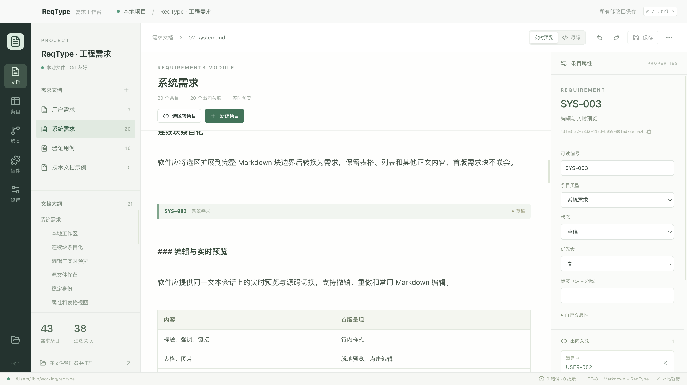
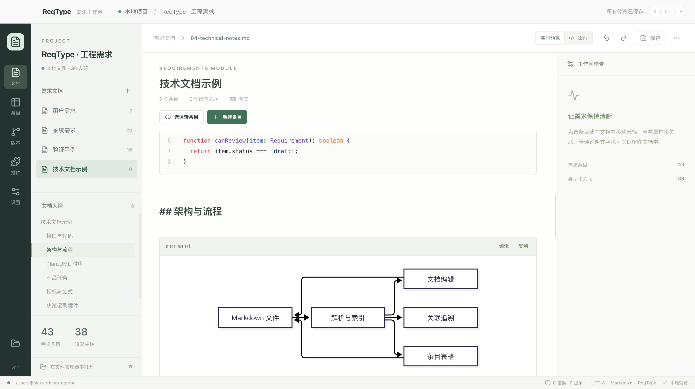

# ReqType

基于 Markdown 的本地需求管理软件，面向 macOS 和 Windows。

用接近 Typora 的编辑体验编写文档，将任意连续内容块映射为具有稳定标识、属性和关联的需求条目，并通过 Git 管理版本。功能理念参考 DOORS，自行定义数据交换和插件机制。

## 开始使用

当前为可运行的 v0.2.0 桌面版本，采用 Electron、TypeScript、React 和 CodeMirror 6。本工程已包含自己的需求工作区：打开项目根目录，即可管理 `requirements/` 下的 57 个条目和跨模块关联。

从 [GitHub Releases](https://github.com/matrixji/reqtype/releases) 下载对应架构的 ZIP，解压后打开 macOS 的 `ReqType.app` 或 Windows 目录内的 `ReqType.exe`，无需安装 Node.js。当前原生检查与发行流程见[开发与发布](docs/delivery.md)，早期本机验证记录保留在 [v0.2.0 验证记录](docs/validation-v0.2.0.md)。

从源码运行需要 Node.js 24 或更新版本，以及用于版本管理的 Git：

```sh
npm ci
npm run setup:git
npm run dev
```

开发启动会优先恢复上次工作区；首次在本仓库运行会打开工程自身需求。也可明确指定：

```sh
npm run dev -- --workspace=/absolute/path/to/workspace
```

生产构建与启动：

```sh
npm run build
npm start
```

## 首版方向

- 本地目录作为项目，可对应一个 Git 仓库；Markdown、配置和附件直接纳入版本管理。
- 项目设置提供需求前缀、本地状态工作流、通用默认值和导出偏好。
- 条目编号自动生成且在项目内唯一；类型支持 Jira／ASPICE 套餐及全项目迁移。
- 按类型配置文本、数值、数组等属性，通过表单快速填写；独立标题支持部分检索。
- 文档编辑、条目表格和关联面板操作同一份源数据。
- 任意连续内容块可转换为条目，保留正文、表格和图片。
- 内置本地 Git 状态、差异、提交和历史查看。
- 支持数据导入导出，以及命令、校验规则、交换适配器和代码块渲染插件。
- 代码高亮、Mermaid、PlantUML（JAR／Server）、公式、任务、脚注、提示块与目录；渲染资源随应用本地打包。
- 保留未来团队协作扩展机会，当前专注本地使用。

内置需求工具箱提供条目统计、待完善内容检查、CSV 表格导出和按行文本导入。完整交换使用原生 JSON 包，包含原始文档、配置与附件；单文件 Markdown 导入导出仅携带该文档。

## 数据格式与升级

项目、Markdown、交换包与本机状态分别定版本，当前项目格式 v2，兼容读取 v1；Markdown 与交换包保持 v1。项目设置中的“数据格式与迁移”可只读检查、预览旧布局升级、保存原文备份并显式恢复。未来版本会被拒写；恢复保护迁移后的人工编辑。详见[格式契约](docs/data-formats.md)。

```sh
npm run data -- check /path/to/project
```

## 验证与打包

```sh
npm test
npm run test:e2e
npm run package -- --out=release/0.2.0
npm run package -- --platform=win32 --arch=x64 --out=release/0.2.0
```

自动化桌面流程在真实 Electron 中运行；测试数据使用临时目录，不修改工程需求。跨平台构建不等同于目标平台运行验证。发行目录尚未签名／公证。

## GitHub 开发与发行

公开仓库为 [matrixji/reqtype](https://github.com/matrixji/reqtype)。后续变更使用工作分支和 Pull Request，三种原生环境检查通过后 squash 合并。服务端要求 PR、最新分支、`CI required` 检查通过及讨论解决，管理员同样受约束；`v*` tag 不可修改或删除。`npm run setup:git` 额外安装本机禁止直接推送 `main` 的钩子。

推送与应用版本一致的 `v*` tag，流水线会重新运行核心、开发版和发行包桌面测试，再创建包含 macOS ARM／Intel 和 Windows x64 ZIP、清单与 SHA-256 的 GitHub Release。手动运行 Release 工作流只构建验证，不发布。详见[开发与发布流程](docs/delivery.md)。

macOS 上架计划与现有桌面发行分开推进；App Sandbox、工作区授权、插件及外部工具仍需适配，当前流水线不提交 App Store。见[Mac App Store 准备](docs/mac-app-store.md)。

## 开源协议

ReqType 使用 [Apache License 2.0](LICENSE)，版权声明见 [NOTICE](NOTICE)。第三方依赖保留各自协议；构建生成 `dist/THIRD_PARTY_NOTICES.txt`，PlantUML 使用 MIT 版本并保留其许可。`package.json` 的 `private: true` 仅禁止误发 npm 包，不影响代码开源。

## 文档

- [产品与技术设计](docs/product-design.md)
- [Markdown 扩展语法草案](docs/markdown-syntax.md)
- [实施顺序与验收标准](docs/implementation-plan.md)
- [需求文档示例](examples/local-save.md)
- [开发协作约定](AGENTS.md)
- [使用说明](docs/usage.md)
- [插件开发](docs/plugins.md)
- [技术文档与离线渲染](docs/markdown-features.md)
- [条目模型与使用说明](docs/project-item-model.md)
- [数据格式版本与迁移](docs/data-formats.md)
- [回归用例矩阵](docs/regression-cases.md)
- [开发与发布流程](docs/delivery.md)
- [Mac App Store 准备](docs/mac-app-store.md)
- [v0.2.0 验证记录与限制](docs/validation-v0.2.0.md)
- [v0.1 历史验证记录](docs/validation.md)

界面预览：




