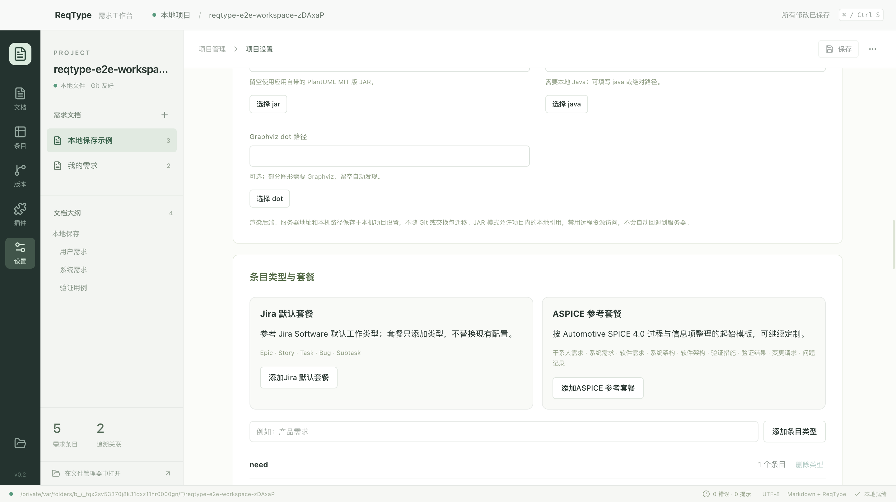
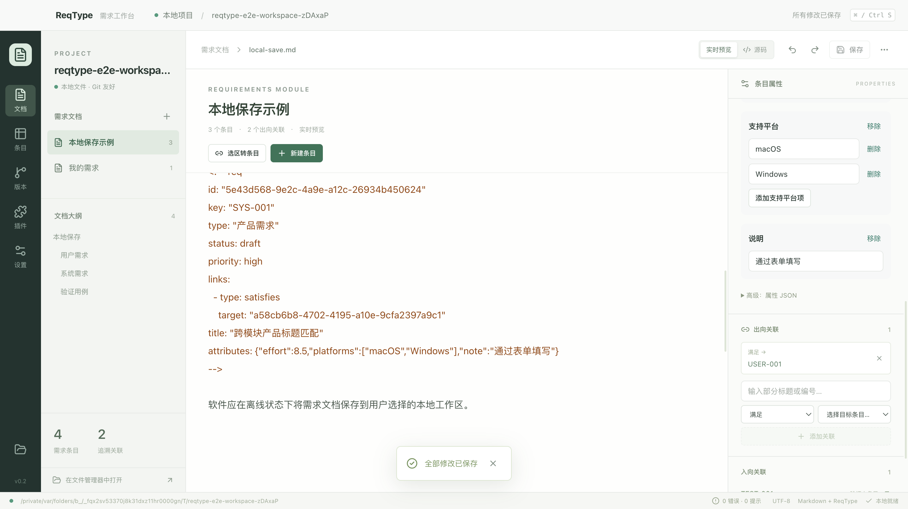

# 编号、类型、属性和标题

从应用 v0.2.0 开始，项目配置格式为 **v2**；Markdown 模块、原生交换包及插件 API 仍为 v1。旧项目继续按 v1 读取，在“项目设置 → 数据格式与迁移”中检查并显式升级，才能使用按类型定义的属性和数组。迁移先备份；不在打开项目时自动改写文件。

## 可读编号

新建、复制及文本导入使用项目配置的前缀与位数，按本项目已有同前缀编号的最大数字递增，生成例如 `PRJ-0007`。删除条目不会使其他条目重新编号；位数是最小补零宽度，不是数量上限。

条目面板中的完整编号只读。已有条目的编号在保存和导入时受到保护，不能通过直接调用保存 IPC 绕过。新增条目保存前检查项目前缀、正整数及项目范围的重复编号；项目内多个模块共用同一编号空间。遇到外部编辑产生的冲突时拒绝保存，重新检查工作区，不静默更换编号。

本次沿用“保留历史编号”的策略：修改**项目**前缀只影响后续新建和复制条目。既有 USER／SYS 等历史编号保留，所有关联继续使用稳定 UUID。原生交换可以保留来自其他项目的历史编号，但不得产生重复或修改当前已存在 UUID 对应的编号。

## 可配置类型与套餐

项目设置支持添加、删除类型，并指定新建默认类型。显示每种类型的在用条目数；仍有条目使用时禁用删除，主进程也会检查。修改原始 YAML 或直接调用设置 IPC 不能绕过在用保护。

两种套餐随应用本地打包，使用时无需联网：

| 套餐 | 类型 |
| --- | --- |
| Jira 默认套餐 | Epic、Story、Task、Bug、Subtask |
| ASPICE 参考套餐 | 干系人需求、系统需求、软件需求、系统架构、软件架构、验证措施、验证结果、变更请求、问题记录 |

Jira 套餐参考 [Atlassian 的软件项目默认类型](https://support.atlassian.com/jira-cloud-administration/docs/what-are-issue-types)。ASPICE 套餐是本应用依据 [Automotive SPICE 4.0 的过程及信息项](https://vda-qmc.de/wp-content/uploads/2023/12/Automotive-SPICE-PAM-v40.pdf)整理的起始配置：需求和架构分别参考 SYS／SWE，验证参考相应验证过程，问题与变更参考 SUP.9／SUP.10。它不是标准规定的统一条目类型清单，也不代表已完成过程评估。

套餐会合并添加类型并设置其默认新建类型，保留已有类型、工作流和数据。可以重复添加，也可以继续增删自定义类型。

### 批量类型迁移

先保存文档及项目设置，再在“项目内批量迁移条目类型”中选择原类型和目标类型。例如“产品需求 → Story”：

1. 预览列出整个项目匹配的编号、标题与模块，预览不写入文件。
2. 检查目标类型未启用的属性；这些值会保留并提示，可随后为目标类型启用。
3. 显式迁移全部匹配条目。只替换类型字段，保留 UUID、可读编号、标题、属性、正文、边界和关联。
4. 原类型的在用数归零后，才可在项目设置中删除。

预览绑定项目、配置和文档清单／哈希，十分钟过期；新增、编辑文档或变更配置后需重新预览。执行使用文件事务，中途失败回滚；完整前镜像在本机事务日志中保留，正常 Git 历史继续可用。这不是格式版本升级，不增加 Markdown 格式版本。

## 属性定义与表单

项目设置中的表单可定义属性标识、显示名称、说明、数据类型和适用条目类型。支持文本、数值、文本数组、数值数组，并兼容此前的布尔值与枚举。

`attributes` 保存共享定义，`typeAttributes` 指定每种条目类型启用哪些定义。例如：

```yaml
version: 2
name: 产品工程
types: [产品需求, Story]
requirement:
  prefix: PRJ
  padding: 4
  defaultType: Story
attributes:
  effort:
    type: number
    label: 工作量
  platforms:
    type: array
    items: string
    label: 支持平台
  note:
    type: string
    label: 说明
typeAttributes:
  产品需求: [effort, platforms, note]
  Story: [effort, platforms]
```

旧 v1 的属性适用于全部类型。v1→v2 迁移为所有既有类型建立同等绑定，保留项目身份、未知字段和属性定义。v1 Schema 留存，v2 Schema 在本地提供。

条目面板展开“自定义属性”，选择项目为当前类型启用的属性后直接填写。数组逐项添加、编辑和删除；数值必须有限且有效。清除字段使用“移除”，不强迫把缺省字段写为空值。JSON 仍在高级入口中保留，便于处理扩展数据。

在用的全局属性定义不能删除；正在被该类型条目使用的属性绑定也不能移除。更改定义的数据类型不得使既有值变得无效。切换／迁移条目类型时不丢弃旧值，未为当前类型启用的值显示保留提示，普通表单不编辑这些值；可在项目设置中启用后继续编辑。

## 独立标题与检索

条目可在属性面板中填写独立标题，保存到需求元数据的 `title` 字段。标题修改不重写正文或其章节标题。旧条目未填写或留空时，沿用从正文提取的标题。

条目表格中的搜索支持标题片段，不区分大小写；编号、正文、标签和模块路径也可搜索。关联选择增加标题／编号片段过滤，并在候选项中显示编号与标题。内置 CSV 导出新增标题列；原生 JSON 与 Markdown 直接保留元数据和原文。

自动化入口：[模型与迁移用例](../tests/item-model.test.ts)、[离线 Schema](../tests/schemas.test.ts)、[真实桌面流程](../tests/e2e/desktop.spec.ts)。

## 实际界面

macOS v0.2.0 发行包的临时项目回归截图，已核对实际视口与文字：




