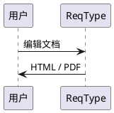

# Markdown 工具栏与导出示例

[TOC]

## 常见排版

**粗体**、*斜体*、~~删除线~~、`inline code` 与 [外部链接](https://example.com)。

- 普通列表
- [x] 工具栏插入
- [ ] 导出检查

| 操作 | 结果 |
| --- | --- |
| HTML | 独立离线文档 |
| PDF | A4 页面 |

> [!NOTE]
> PlantUML 默认使用本机 Java 与应用附带 JAR。

## 代码与图表

```typescript
const supported = ['Markdown', 'Mermaid', 'PlantUML'];
```




## 公式与脚注

行内公式 $x^2$。

$$
E=mc^2
$$

导出保留脚注[^export]。

[^export]: 图表失败会停止导出，保留已有目标文件。
