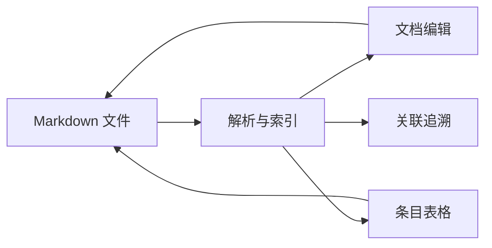
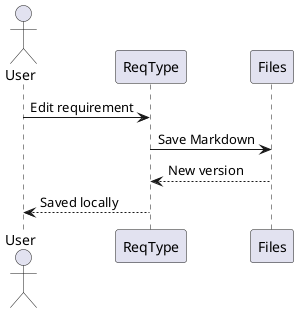

# 技术文档示例

这些内容直接存储为 Markdown，可与需求条目使用同样的编辑器。代码、图形和公式均可放进一个连续内容块需求。

[TOC]

## 接口与代码

```typescript title="Requirement.ts"
interface Requirement {
  id: string;
  status: 'draft' | 'reviewed' | 'approved';
}

function canReview(item: Requirement): boolean {
  return item.status === 'draft';
}
```

## 架构与流程



## PlantUML 时序

默认使用本地 JAR，需要本机 Java；可在项目设置中更换后端。



## 产品任务

- [ ] 补充典型产品文档样例
- [x] 明确本地优先原则
- [x] 保留 Markdown 文件所有权

> [!IMPORTANT]
> 修改正文或勾选任务后需要保存；保存与 Git 提交是独立操作。

## 指标与公式

覆盖率可描述为 $C = N_v / N_r$，其中 $N_v$ 是有验证关联的需求数量。

$$
C_{percent} = \frac{N_v}{N_r} \times 100\%
$$

## 决策记录插件

下方 `decision` 卡片由内置需求工具箱提供，可作为自定义代码块插件的例子。

```decision
{"title":"优先使用本地资源","status":"已记录","reason":"编辑、代码高亮、图形与公式不依赖公网 CDN；项目可用 Git 管理。"}
```

## 补充说明

需求的稳定身份与可读编号分别管理[^identity]。

[^identity]: 改变前缀不会改写现有条目编号，移动条目不改变 UUID。
